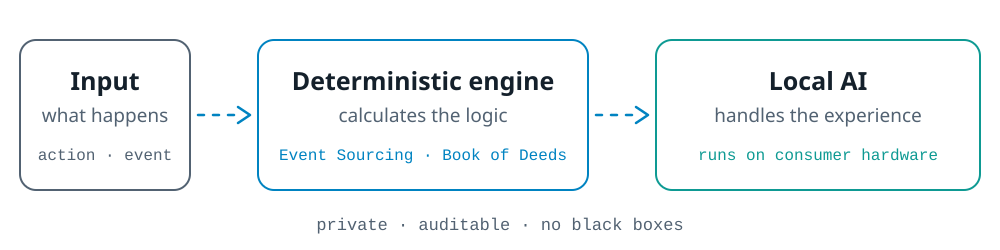

  <a href="https://zeldris.github.io/Portal-Galivelop/en/">
  <picture>
    <source media="(prefers-color-scheme: dark)" srcset="assets/banner-dark.svg">
    
  </picture>
  </a>

  <strong>Software Architect & AI Systems Engineer</strong> 
  Local-first infrastructure and deterministic systems · A Coruña, Spain

  
  
  
  
  

- 💼 Full-stack developer since 2017 and, since 2023, senior developer at Orienteed.
- 🚀 Founder of **[Galivelop](https://zeldris.github.io/Portal-Galivelop/en/)**, a software workshop where we create, research and learn by building ambitious software, in the open.
- 🧭 See [my profile](https://zeldris.github.io/Portal-Galivelop/en/equipo/alvaro-garcia-grana) and [what's new](https://zeldris.github.io/Portal-Galivelop/en/novedades) on the portal.

## What I do

I design and build software where the deterministic engine calculates the logic and local AI handles the experience. I focus on creating robust, private, and auditable systems, avoiding "black boxes" and cloud AI hallucinations.

  <picture>
    <source media="(prefers-color-scheme: dark)" srcset="assets/approach-dark.svg">
    
  </picture>

<table>
  <tr>
    <td width="50%" valign="top">
       
      <strong>Custom Full-Stack Development</strong> 
      From database to UI. Scalable backends with Fastify (Node.js) or Spring Boot (Java).
    </td>
    <td width="50%" valign="top">
       
      <strong>Local AI Architecture</strong> 
      LLM implementation on consumer hardware (optimized for Steam Deck and modest PCs). Subagent orchestration and persistent context management.
    </td>
  </tr>
  <tr>
    <td width="50%" valign="top">
       
      <strong>Deterministic Systems & Simulation</strong> 
      Game engines and tools where the world state is predictable (Event Sourcing, "Book of Deeds").
    </td>
    <td width="50%" valign="top">
       
      <strong>Agent Workflows</strong> 
      Methodologies (based on AGENTS.md and Git hooks) for teams using AI to avoid losing context between sessions.
    </td>
  </tr>
</table>

## Featured Projects

Every project has its own page on the [Galivelop portal](https://zeldris.github.io/Portal-Galivelop/en/): what it is, how it works, gallery, tech sheet and roadmap.

<table>
  <tr>
    <td width="150"></td>
    <td>
      <strong><a href="https://zeldris.github.io/Portal-Galivelop/en/proyectos/tarkor">Tarkor</a></strong> · 🟡 Alpha 
      Narrative text RPG with a local AI as game master, on a deterministic engine: the world moves on even when you stop. 9 living factions, 9 classes with 31 specialisations, 4.8k+ tests, plus its own image and voice generation pipelines. Ships with a desktop installer (<code>.exe</code> / <code>.AppImage</code>) so there is no Node, Postgres or Ollama to set up by hand. 
      TypeScript · React · Fastify · Prisma · PostgreSQL · Ollama · Tauri v2 · Rust · SQLite 
      <a href="https://zeldris.github.io/Portal-Galivelop/en/proyectos/tarkor">Project page</a> · <a href="https://github.com/Zeldris/World-Maker-Fantasy">Game code</a> · <a href="https://github.com/Zeldris/Instalador-WMF-Tarkor">Installer code</a>
    </td>
  </tr>
  <tr>
    <td width="150"></td>
    <td>
      <strong><a href="https://www.toveriai.com">toVeriAI</a></strong> · 🟢 Live 
      AI news credibility platform. It scores news, links and screenshots with the IMI index, from 0 to 100 (7 dimensions for text, 9 for URLs, based on NewsGuard), and explains what fails and where. 5 languages. Co-developed final-year project. 
      React · Spring Boot · Java · MySQL 
      <a href="https://zeldris.github.io/Portal-Galivelop/en/proyectos/toveriai">Project page</a> · <a href="https://www.toveriai.com">toveriai.com</a>
    </td>
  </tr>
  <tr>
    <td width="150"></td>
    <td>
      <strong><a href="https://github.com/Zeldris/Galivelop-workflow">Galivelop-workflow</a></strong> · 🟡 v0.5.1 
      Open-source workflow for AI coding agents (Claude Code first): lossless hand-offs between sessions, a skill/model selector, and Git hooks that keep unreviewed code out of <code>main</code>. 
      Bash · Python · Git Hooks · Agent Skills 
      <a href="https://zeldris.github.io/Portal-Galivelop/en/proyectos/galivelop-workflow">Project page</a> · <a href="https://github.com/Zeldris/Galivelop-workflow">Code</a>
    </td>
  </tr>
  <tr>
    <td width="150"></td>
    <td>
      <strong><a href="https://github.com/Zeldris/galivelop-image-generator">Galivelop IG</a></strong> · 🟡 v0.4.1 
      Local AI image generator: one service per machine shared by several projects, with a persistent queue, attempts/selection/delivery, a CLI, a local HTTP API and a browser UI. Runs on stable-diffusion.cpp, with the Steam Deck as its reference machine. 
      Python (stdlib only) · stable-diffusion.cpp 
      <a href="https://zeldris.github.io/Portal-Galivelop/en/proyectos/galivelop-image-generator">Project page</a> · <a href="https://github.com/Zeldris/galivelop-image-generator">Code</a>
    </td>
  </tr>
</table>

**Also**

- **[Portal-Galivelop](https://github.com/Zeldris/Portal-Galivelop):** the workshop portal itself, with every project as it really is, in Spanish, Galician and English (React, TypeScript, Vite).
- **Galivelop Voice Generator** (coming soon): voices generated with local AI for the workshop's projects.
- **Galivelop Developer** (coming soon): a local AI development agent that works without relying on the cloud.

Galivelop-workflow and Galivelop IG are open source, and I can set them up and support them in your project: [get in touch](mailto:alvarogarciagrana@gmail.com).

## Things I code with

**Day to day**

<strong>Also worked with</strong> (26 more)

 

## My Work Philosophy

> *"If it isn't pushed, it doesn't exist."*

<table>
  <tr>
    <td width="33%" valign="top">
      <h3>01</h3>
      <strong>Automated Quality</strong> 
      Git hooks block unreviewed code or failing tests. Nothing reaches <code>main</code> without passing the filter.
    </td>
    <td width="33%" valign="top">
      <h3>02</h3>
      <strong>Fault-Tolerant Context</strong> 
      State lives in files, not in the agent's memory. Handoffs between sessions are lossless.
    </td>
    <td width="33%" valign="top">
      <h3>03</h3>
      <strong>Measured Optimization</strong> 
      Before cutting tokens or performance, I measure where the resource is going. Savings that worsen the product aren't savings.
    </td>
  </tr>
</table>

## Let's work together

If you have a technical challenge, need to build a full-stack application, or want to explore how to apply local AI and deterministic workflows to your project, I'm always open to hearing ideas and seeing how I can add value.

Galivelop grows with the people who join it. No prior experience needed, just the will to build, learn and do it as a team:

- 🛠️ [Join the workshop](https://zeldris.github.io/Portal-Galivelop/en/participa/unirse) and contribute to an open project.
- 💡 [Propose a project](https://zeldris.github.io/Portal-Galivelop/en/participa/proponer) that feels too big to build alone.
- 💬 Join the community on [Discord](https://discord.gg/HWakpsAv3V).

📫 **Contact**

- **Development & Collaborations:** [alvarogarciagrana@gmail.com](mailto:alvarogarciagrana@gmail.com)
- **toVeriAI Support:** [web.admin.toveriai@gmail.com](mailto:web.admin.toveriai@gmail.com)
