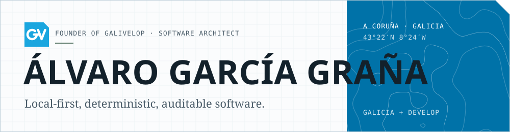
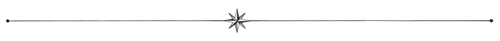
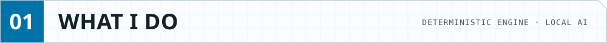
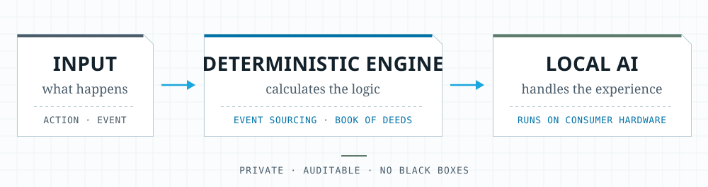
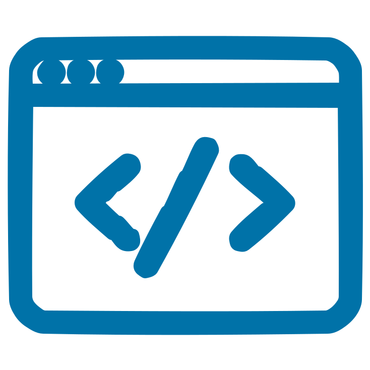
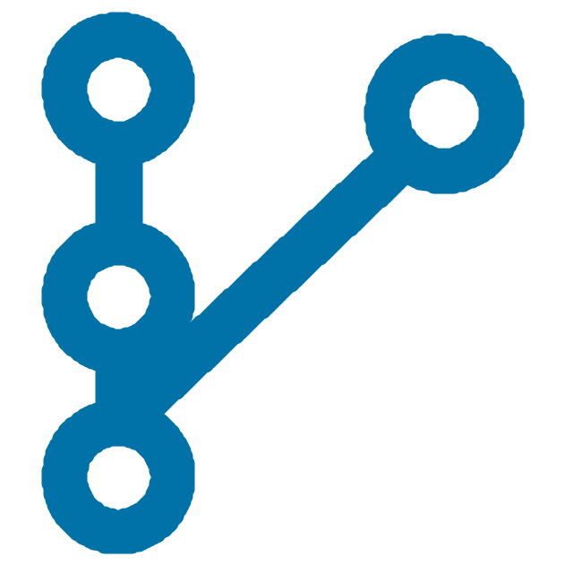
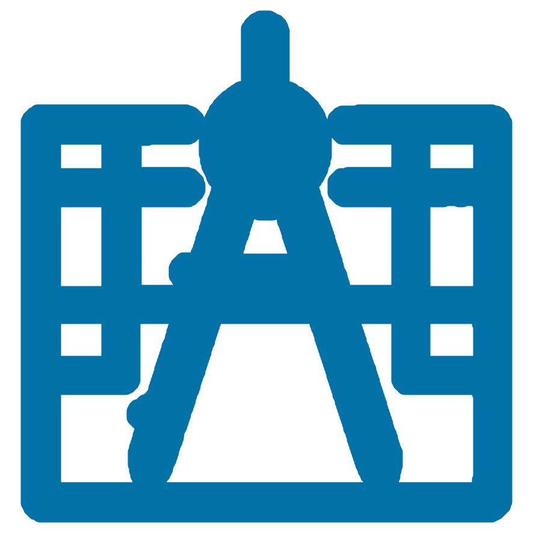

  <a href="https://zeldris.github.io/Portal-Galivelop/en/">
  <picture>
    <source media="(max-width: 600px) and (prefers-color-scheme: dark)" srcset="assets/banner-mobile-dark.svg">
    <source media="(max-width: 600px)" srcset="assets/banner-mobile-light.svg">
    <source media="(prefers-color-scheme: dark)" srcset="assets/banner-dark.svg">
    
  </picture>
  </a>

  <strong>Software Architect & AI Systems Engineer</strong> 
  Local-first infrastructure and deterministic systems · A Coruña, Spain

  
  
  
  
  

- 💼 Full-stack developer since 2017 and, since 2023, senior developer at Orienteed.
- 🚀 Founder of **[Galivelop](https://zeldris.github.io/Portal-Galivelop/en/)**, a software workshop where we create, research and learn by building ambitious software, in the open.
- 🧭 Everything lives on the portal: [my profile](https://zeldris.github.io/Portal-Galivelop/en/equipo/alvaro-garcia-grana), [what's new](https://zeldris.github.io/Portal-Galivelop/en/novedades) and the [workshop diary](https://zeldris.github.io/Portal-Galivelop/en/diario). The portal itself is [open source too](https://github.com/Zeldris/Portal-Galivelop).

  <picture>
    <source media="(prefers-color-scheme: dark)" srcset="assets/separator-dark.webp">
    
  </picture>

<picture>
  <source media="(max-width: 600px) and (prefers-color-scheme: dark)" srcset="assets/section-what-i-do-mobile-dark.svg">
  <source media="(max-width: 600px)" srcset="assets/section-what-i-do-mobile-light.svg">
  <source media="(prefers-color-scheme: dark)" srcset="assets/section-what-i-do-dark.svg">
  
</picture>

<strong>How I build software</strong>

  <picture>
    <source media="(prefers-color-scheme: dark)" srcset="assets/separator-dark.webp">
    
  </picture>

I design and build software where the deterministic engine calculates the logic and local AI handles the experience. I focus on creating robust, private, and auditable systems, avoiding "black boxes" and cloud AI hallucinations.

  <picture>
    <source media="(max-width: 600px) and (prefers-color-scheme: dark)" srcset="assets/approach-mobile-dark.svg">
    <source media="(max-width: 600px)" srcset="assets/approach-mobile-light.svg">
    <source media="(prefers-color-scheme: dark)" srcset="assets/approach-dark.svg">
    
  </picture>

<table>
  <tr>
    <td width="50%" valign="top">
      <picture><source media="(prefers-color-scheme: dark)" srcset="assets/icon-fullstack-dark.svg"></picture> 
      <strong>Custom Full-Stack Development</strong> 
      From database to UI. Scalable backends with Fastify (Node.js) or Spring Boot (Java).
    </td>
    <td width="50%" valign="top">
      <picture><source media="(prefers-color-scheme: dark)" srcset="assets/icon-local-ai-dark.svg"></picture> 
      <strong>Local AI Architecture</strong> 
      LLM implementation on consumer hardware (optimized for Steam Deck and modest PCs). Subagent orchestration and persistent context management.
    </td>
  </tr>
  <tr>
    <td width="50%" valign="top">
      <picture><source media="(prefers-color-scheme: dark)" srcset="assets/icon-deterministic-dark.svg"></picture> 
      <strong>Deterministic Systems & Simulation</strong> 
      Game engines and tools where the world state is predictable (Event Sourcing, "Book of Deeds").
    </td>
    <td width="50%" valign="top">
      <picture><source media="(prefers-color-scheme: dark)" srcset="assets/icon-agents-dark.svg"></picture> 
      <strong>Agent Workflows</strong> 
      Methodologies (based on AGENTS.md and Git hooks) for teams using AI to avoid losing context between sessions.
    </td>
  </tr>
</table>

<picture>
  <source media="(max-width: 600px) and (prefers-color-scheme: dark)" srcset="assets/section-featured-projects-mobile-dark.svg">
  <source media="(max-width: 600px)" srcset="assets/section-featured-projects-mobile-light.svg">
  <source media="(prefers-color-scheme: dark)" srcset="assets/section-featured-projects-dark.svg">
  
</picture>

<strong>See the four projects</strong>

  <picture>
    <source media="(prefers-color-scheme: dark)" srcset="assets/separator-dark.webp">
    
  </picture>

Every project has its own page on the [Galivelop portal](https://zeldris.github.io/Portal-Galivelop/en/): what it is, how it works, gallery, tech sheet and roadmap.

<table>
  <tr>
    <td>
      
      <strong><a href="https://zeldris.github.io/Portal-Galivelop/en/proyectos/tarkor">Tarkor</a></strong> · 🟡 Alpha · milestone 0.3 “Deep kingdom”: play-testing round 
      <em>A narrative RPG where the world moves on even when you stop.</em> A text role-playing game with a local AI as game master: factions, wildlife and your kingdom live on their own, you write what you do, the engine resolves it with visible dice rolls and a narrator tells the story. 9 living factions, 9 classes with 31 specialisations, 53 wildlife species, 245 items and 4,200+ automated tests, with all of the AI running on your machine. Ships with a desktop installer (<code>.exe</code> / <code>.AppImage</code>) so there is no Node, Postgres or Ollama to set up by hand. 
      TypeScript · React · Fastify · Prisma · PostgreSQL · Ollama · Tauri v2 · Rust · SQLite 
      <a href="https://zeldris.github.io/Portal-Galivelop/en/proyectos/tarkor">Project page</a> · <a href="https://github.com/Zeldris/World-Maker-Fantasy">Game code</a> · <a href="https://github.com/Zeldris/Instalador-WMF-Tarkor">Installer code</a>
    </td>
  </tr>
  <tr>
    <td>
      
      <strong><a href="https://www.toveriai.com">toVeriAI</a></strong> · 🟢 Live · screenshot analysis paused 
      <em>Truth isn’t binary.</em> An AI news credibility platform: it analyses news and links and returns the IMI, a 0–100 score (7 dimensions for text, 9 for links, based on NewsGuard) that shows what is wrong and where. 5 languages, 5 AI providers in rotation, and comfortable to use on a phone. Co-developed final-year project. 
      React · Spring Boot · Java · MySQL · Ollama 
      <a href="https://zeldris.github.io/Portal-Galivelop/en/proyectos/toveriai">Project page</a> · <a href="https://www.toveriai.com">toveriai.com</a>
    </td>
  </tr>
  <tr>
    <td>
      
      <strong><a href="https://github.com/Zeldris/Galivelop-workflow">Galivelop-workflow</a></strong> · 🟡 v0.9.1 · next: 0.10 “Stable” 
      <em>If it isn’t pushed, it doesn’t exist: the way we work with AI, packaged for any project.</em> An open-source workflow for AI coding agents (Claude Code first, also installs for opencode and Codex): lossless hand-offs between sessions, the right skill and model picked before starting, mandatory review before publishing, and fewer tokens without losing quality. Configurable languages, install profiles per person and per role, and interface tests with screenshots and accessibility checks. 14 skills of its own plus 15 by Matt Pocock, 3,981 automated tests and 4 pilot projects. 
      Bash · Python · Git Hooks · Agent Skills · AGENTS.md 
      <a href="https://zeldris.github.io/Portal-Galivelop/en/proyectos/galivelop-workflow">Project page</a> · <a href="https://github.com/Zeldris/Galivelop-workflow">Code</a> · <a href="https://github.com/Zeldris/Galivelop-workflow/releases/tag/v0.9.1">v0.9.1</a>
    </td>
  </tr>
  <tr>
    <td>
      
      <strong><a href="https://github.com/Zeldris/galivelop-image-generator">Galivelop IG</a></strong> · 🟡 v0.8.0 · next: note and discard 
      <em>Ask, try, choose.</em> A local AI image-generation service, one per machine and shared by every workshop project: it takes requests, generates attempts, lets you choose one and delivers it with its manifest. Nothing leaves the machine. Each project describes its brand as a data sheet; in brand mode the service builds and checks the request from it and warns if it breaks the vetoes. Runs on stable-diffusion.cpp with the Steam Deck as its reference machine. 1,951 automated tests, 8 pilot rounds, 7 projects with a brand bible, 6 of 12 phases done. 
      Python · stable-diffusion.cpp · FLUX.2 · Vulkan · CLI 
      <a href="https://zeldris.github.io/Portal-Galivelop/en/proyectos/galivelop-image-generator">Project page</a> · <a href="https://github.com/Zeldris/galivelop-image-generator">Code</a> · <a href="https://github.com/Zeldris/galivelop-image-generator/releases/tag/v0.8.0">v0.8.0</a>
    </td>
  </tr>
</table>

Galivelop-workflow and Galivelop IG are open source, and I can set them up and support them in your project: [get in touch](mailto:alvarogarciagrana@gmail.com).

<picture>
  <source media="(max-width: 600px) and (prefers-color-scheme: dark)" srcset="assets/section-products-mobile-dark.svg">
  <source media="(max-width: 600px)" srcset="assets/section-products-mobile-light.svg">
  <source media="(prefers-color-scheme: dark)" srcset="assets/section-products-dark.svg">
  
</picture>

<strong>See the two products</strong>

  <picture>
    <source media="(prefers-color-scheme: dark)" srcset="assets/separator-dark.webp">
    
  </picture>

What the workshop will offer, built on what its projects have proven.

<table>
  <tr>
    <td width="50%" valign="top">
       
      <strong><a href="https://zeldris.github.io/Portal-Galivelop/en/productos/galivelop-developer">Galivelop Developer</a></strong> · ⚪ Coming soon 
      <em>Your workflow, with AI on your machine.</em> Aka GalivelopCode. It connects the workshop’s workflow to AI agents that run on your own computer. They carry the project’s work and you decide what goes in. No mandatory cloud and no pay-per-use.
    </td>
    <td width="50%" valign="top">
      <a href="https://zeldris.github.io/Portal-Galivelop/en/productos/galivelop-evaluator"><picture><source media="(prefers-color-scheme: dark)" srcset="https://raw.githubusercontent.com/Zeldris/Portal-Galivelop/main/public/productos/galivelop-evaluator/gve-evaluacion-oscuro-mini.webp"></picture></a> 
      <strong><a href="https://zeldris.github.io/Portal-Galivelop/en/productos/galivelop-evaluator">Galivelop Evaluator</a></strong> · ⚪ Coming soon 
      <em>Measure first, improve with proof.</em> Aka GVE. You change a prompt, a model or the way it searches, and it seems to work better: it measures before and after with the same questions and shows plainly what got better and what got worse, with results you can repeat.
    </td>
  </tr>
</table>

<picture>
  <source media="(max-width: 600px) and (prefers-color-scheme: dark)" srcset="assets/section-coming-soon-mobile-dark.svg">
  <source media="(max-width: 600px)" srcset="assets/section-coming-soon-mobile-light.svg">
  <source media="(prefers-color-scheme: dark)" srcset="assets/section-coming-soon-dark.svg">
  
</picture>

<strong>See the five projects under way</strong>

  <picture>
    <source media="(prefers-color-scheme: dark)" srcset="assets/separator-dark.webp">
    
  </picture>

Projects already under way that don’t have their own page yet.

- **Galivelop Voice Generator** · 2 of 8 phases · next: the real voice engine 
  Voices generated with local AI for the workshop’s projects. You can already [listen to the portal](https://zeldris.github.io/Portal-Galivelop/en/diario/escribir-para-el-oido) in one.
- **Galivelop Forge** · 1 of 8 phases · next: the training data 
  A data and fine-tuning factory for the workshop’s local models.
- **Galivelop Runtime** · 4 of 7 phases · next: the shared Ollama turn 
  The shared core of the local generators: queue, turns and a shared machine lock.
- **Galivelop Worlds** · 2 of 7 phases · next: imported maps with their topology 
  A kit for making living fictional worlds with local AI.
- **Model Atlas** · 2 of 5 phases · next: the schemas and the fit 
  Which model fits on which machine.

<picture>
  <source media="(max-width: 600px) and (prefers-color-scheme: dark)" srcset="assets/section-things-i-code-with-mobile-dark.svg">
  <source media="(max-width: 600px)" srcset="assets/section-things-i-code-with-mobile-light.svg">
  <source media="(prefers-color-scheme: dark)" srcset="assets/section-things-i-code-with-dark.svg">
  
</picture>

<strong>See the full stack</strong>

  <picture>
    <source media="(prefers-color-scheme: dark)" srcset="assets/separator-dark.webp">
    
  </picture>

**Day to day**

<strong>Also worked with</strong> (30 more)

 

<picture>
  <source media="(max-width: 600px) and (prefers-color-scheme: dark)" srcset="assets/section-experience-mobile-dark.svg">
  <source media="(max-width: 600px)" srcset="assets/section-experience-mobile-light.svg">
  <source media="(prefers-color-scheme: dark)" srcset="assets/section-experience-dark.svg">
  
</picture>

<strong>See career, education and languages</strong>

  <picture>
    <source media="(prefers-color-scheme: dark)" srcset="assets/separator-dark.webp">
    
  </picture>

- **Senior full-stack software developer** · Orienteed · 2023 – now 
  Luxottica, Ezpeleta, PLADUR, Mayoral · B2C and B2B
- **Full-stack software developer** · Orienteed · 2021 – 2023
- **Full-stack web developer** · Plexus Tech · 2020 – 2021 
  Luckia · B2C
- **Full-stack web developer** · Servicio Móvil · 2018 – 2020 
  Inditex, Sergas · B2C
- **Full-stack web developer** · Grupo ALUMAN · 2017 · B2B

**Education:** Higher Technician in Web Application Development (2017–2018) · Higher Technician in Multiplatform Application Development (2014–2016)

**Languages:** Galician and Spanish (native) · English (intermediate)

<picture>
  <source media="(max-width: 600px) and (prefers-color-scheme: dark)" srcset="assets/section-my-work-philosophy-mobile-dark.svg">
  <source media="(max-width: 600px)" srcset="assets/section-my-work-philosophy-mobile-light.svg">
  <source media="(prefers-color-scheme: dark)" srcset="assets/section-my-work-philosophy-dark.svg">
  
</picture>

<strong>See the three principles</strong>

  <picture>
    <source media="(prefers-color-scheme: dark)" srcset="assets/separator-dark.webp">
    
  </picture>

> *"If it isn't pushed, it doesn't exist."*

<table>
  <tr>
    <td width="33%" valign="top">
      <h3>01</h3>
      <strong>Automated Quality</strong> 
      Git hooks block unreviewed code or failing tests. Nothing reaches <code>main</code> without passing the filter.
    </td>
    <td width="33%" valign="top">
      <h3>02</h3>
      <strong>Fault-Tolerant Context</strong> 
      State lives in files, not in the agent's memory. Handoffs between sessions are lossless.
    </td>
    <td width="33%" valign="top">
      <h3>03</h3>
      <strong>Measured Optimization</strong> 
      Before cutting tokens or performance, I measure where the resource is going. Savings that worsen the product aren't savings.
    </td>
  </tr>
</table>

<picture>
  <source media="(max-width: 600px) and (prefers-color-scheme: dark)" srcset="assets/section-lets-work-together-mobile-dark.svg">
  <source media="(max-width: 600px)" srcset="assets/section-lets-work-together-mobile-light.svg">
  <source media="(prefers-color-scheme: dark)" srcset="assets/section-lets-work-together-dark.svg">
  
</picture>

<strong>See how to get in touch</strong>

  <picture>
    <source media="(prefers-color-scheme: dark)" srcset="assets/separator-dark.webp">
    
  </picture>

If you have a technical challenge, need to build a full-stack application, or want to explore how to apply local AI and deterministic workflows to your project, I'm always open to hearing ideas and seeing how I can add value. Independently of Galivelop, I occasionally work on other people’s projects: full-stack development with React, TypeScript, Java and Spring.

Galivelop grows with the people who join it. No prior experience needed, just the will to build, learn and do it as a team:

- 🛠️ [Join the workshop](https://zeldris.github.io/Portal-Galivelop/en/participa/unirse) and contribute to an open project.
- 💡 [Propose a project](https://zeldris.github.io/Portal-Galivelop/en/participa/proponer) that feels too big to build alone.
- 💬 Join the community on [Discord](https://discord.gg/HWakpsAv3V).

📫 **Contact**

- **Development & Collaborations:** [alvarogarciagrana@gmail.com](mailto:alvarogarciagrana@gmail.com)
- **toVeriAI Support:** [web.admin.toveriai@gmail.com](mailto:web.admin.toveriai@gmail.com)

